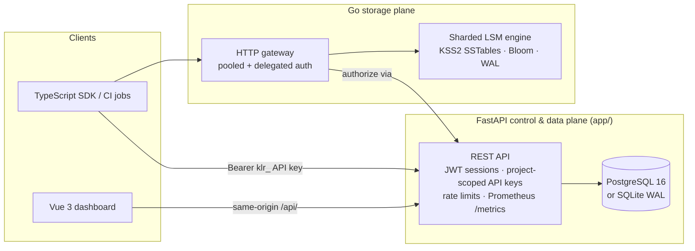

# Kestrel

Kestrel is an open, high-density database platform built for clarity and dataset scale: a FastAPI control & data plane with transparent payload compression and secondary B-tree indexes, a sharded Go LSM-tree storage engine with block-compressed SSTables and Bloom filters, an authorizing Go HTTP gateway, a dependency-free TypeScript client, and a Vue workspace dashboard.

[](https://github.com/authorsauravkushwaha/My_DATABASE159/actions/workflows/ci.yml)
[](LICENSE)
[](https://www.python.org/)
[](https://go.dev/)
[](apps/dashboard/)
[](CHANGELOG.md)

## Why Kestrel Stores Much Larger Datasets per GB

Default BaaS setups (such as uncompressed Supabase JSONB tables accessed via single-row REST calls and `OFFSET` pagination) hit TOAST/MVCC storage amplification, round-trip write bottlenecks, and slow deep scans as datasets scale. Kestrel upgrades every layer of the stack:

| Capability | Typical Default BaaS Setup | Kestrel High-Capacity Architecture |
| --- | --- | --- |
| **Record storage density** | Uncompressed JSON/JSONB rows + MVCC bloat | **Transparent `KZ1` Zlib record compression** in SQL + **`KSS2` 32 KiB block-compressed SSTables** (~35× compression on structured JSON in `engine/scale_test.go`) |
| **Point lookups & read I/O** | Full JSONB fetch or manual SQL expression DDL | **Online secondary B-tree field indexes** (`record_field_indexes`) + **10-bit/key SSTable Bloom filters** + **shared concurrent LRU block cache** |
| **Write throughput** | Single-row HTTP round-trips | **Atomic `/batch` & `/import` NDJSON endpoints** (up to **5,000 records / 16 MiB** per call) + **pooled 16-conn gateway** + **binary batch WAL** across **`N` LSM hash shards** |
| **Deep pagination & exports** | Linear `OFFSET` scans & buffered JSON responses | **O(1) keyset cursor pagination** (`after=<id>`) + **constant-memory streaming NDJSON `/export`** |
| **Schema capacity** | Ad-hoc or rigid DDL migrations | Closed, validated schemas up to **128 fields**, **512 KiB per record**, **16 secondary indexes**, and **64 virtual hash shards** |

## Architecture



- **`app/` — FastAPI Control & High-Capacity Data Plane**: Manages users, organizations, memberships, projects, collection schemas, `KZ1`-compressed records, online secondary B-tree indexes, predicate-pushdown `/query`, `/batch`, streaming NDJSON `/import` & `/export`, `/compact`, `/storage` telemetry, project-scoped API keys, per-client fixed-window rate limiting, and Prometheus metrics. Supports PostgreSQL 16 and tuned WAL-mode SQLite.
- **`engine/` — Sharded Go LSM Storage Engine**: Multi-shard LSM-tree (`ShardedStore`) featuring binary batch CRC32 WAL, exclusive directory `flock`, `KSS2` Zlib block-compressed SSTables with per-block CRC32 checksums, Kirsch-Mitzenmacher Bloom filters, shared LRU block cache, and streaming k-way merge compaction (~8 MiB target SSTable splits).
- **`gateway/` — Pooled Go HTTP Data Gateway**: Authorizes bearer tokens (sessions or API keys) through FastAPI (`/internal/v1/gateway/authorize`) and serves single-record CRUD, 5,000-op `/batch`, collection `DELETE` prefix purge, `/compact`, and `/v1/stats/{project}/{collection}` over a 16-connection auto-reconnecting TCP pool.
- **`packages/client/` — `@kestrel/client`**: Zero-dependency TypeScript SDK supporting single & batch CRUD, B-tree indexed queries, cursor pagination, streaming NDJSON import/export, index management, API-key lifecycle, compaction, and storage telemetry.
- **`apps/dashboard/` — Vue 3 Workspace**: Calm interface for managing projects, 128-field schemas, online B-tree indexes, bulk batch/NDJSON ingestion, server-side indexed queries, API keys with one-time secret display, and real-time compression density metrics.

## Quickstart with Docker Compose

Prerequisites: Docker 24+ with Docker Compose v2, plus Bash and Python 3 or OpenSSL to generate `.env`.

```bash
bash scripts/setup.sh --env-only
docker compose up --build
```

Open `http://localhost:3000` for the dashboard, `http://localhost:8000/health` for the FastAPI control/data plane, `http://localhost:8000/metrics` for Prometheus scrape output, and `http://localhost:8100/health` for the Go data gateway (backed by a 4-shard Go LSM storage engine).

## Local Development Without Docker

Prerequisites: Python 3.11+, Node.js 22+ with npm 10+, and Go 1.22+ for `engine/` and `gateway/`.

```bash
bash scripts/setup.sh
bash scripts/dev.sh
```

`scripts/dev.sh` runs `alembic upgrade head`, starts FastAPI on `http://127.0.0.1:8000`, and starts the Vite dashboard on `http://127.0.0.1:5173` with `/api` proxied to FastAPI.

## High-Capacity API Highlights

| Endpoint | Description |
| --- | --- |
| `POST /v1/projects/{id}/data/{collection}/batch` | Atomic compressed batch insert of up to **5,000 records** (16 MiB max). |
| `POST /v1/projects/{id}/data/{collection}/import` | Bulk ingest newline-delimited JSON (`application/x-ndjson`). |
| `GET /v1/projects/{id}/data/{collection}/export` | Constant-memory streaming NDJSON export of an entire collection. |
| `POST /v1/projects/{id}/data/{collection}/query` | Predicate-pushdown query (`eq`, `neq`, `gt`, `gte`, `lt`, `lte`, `in`, `contains`, `prefix`) with B-tree index acceleration and `after` cursor. |
| `POST /v1/projects/{id}/collections/{collection}/indexes` | Online creation & backfill of a secondary B-tree scalar field index. |
| `POST /v1/projects/{id}/collections/{collection}/compact` | Re-compress uncompressed records and return updated storage savings. |
| `GET /v1/projects/{id}/storage` | Per-project and per-collection raw bytes, stored bytes, compression ratio, shard spread, and LSM engine stats. |
| `POST/GET /v1/projects/{id}/api-keys` · `DELETE .../api-keys/{key}` | Mint (secret shown once), list, and revoke project-scoped `reader`/`writer` API keys with optional expiry. |
| `GET /metrics` | Prometheus text metrics: request counters, latency histograms, build info (optionally gated by `METRICS_TOKEN`). |

Authentication accepts either a 15-minute session JWT or a project-scoped `klr_…` API key. Two fixed-window rate limiters ship in-process — a strict per-IP window on `/v1/auth/*` (default 20/min) and a global window (default 1200/min), tunable via `RATE_LIMIT_*` environment variables.

## Verification

```bash
bash scripts/check.sh
```

Runs workspace dependency checks, Ruff linting, Python unit/migration/high-capacity/API-key/observability/gateway-integration tests, Go `engine` and `gateway` `-race` tests, TypeScript client tests, dashboard Vitest tests, `vue-tsc` typechecking, ESLint, and production builds.

## License

[MIT](LICENSE)
