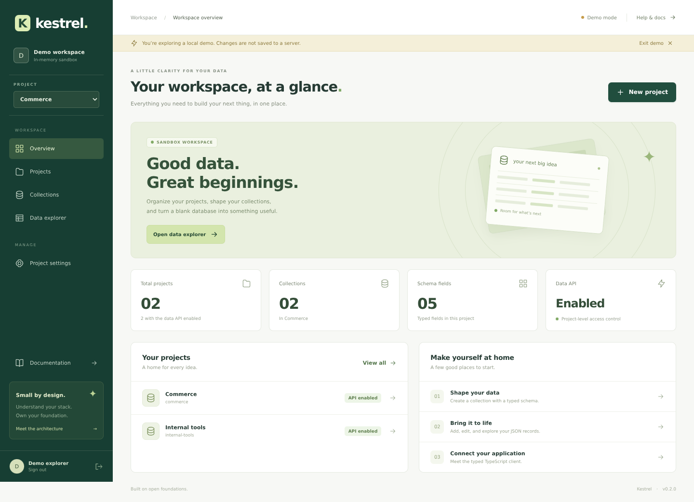

# Kestrel

**A small, open database platform with a workspace you can actually use.**

Kestrel combines a tenant-aware PostgreSQL control plane, an experimental Go key-value storage engine, a Vue/TypeScript dashboard, and a dependency-free TypeScript client. It is a working MVP—not a production-ready Supabase replacement.



## What works

- **Workspace:** registration/sign-in, project creation and switching, collection schema builder, record create/edit/delete, page search, JSON-page export, API toggle, and confirmed destructive actions.
- **Control plane:** organizations and membership checks, short-lived bearer tokens, salted password hashing, typed JSON collections, bounded pagination, and project-scoped CRUD.
- **Storage plane:** Go LSM engine with WAL, SSTables, compaction, torn-tail recovery, and an HTTP gateway that delegates authorization to the control plane.
- **Developer experience:** Alembic migrations, Docker Compose, typed SDK, interactive MDX guide, reproducible npm workspaces, linting, unit tests, browser tests, and CI.
- **Honest demo:** the dashboard's demo mode is explicitly labeled, runs entirely in memory, and resets on refresh. It never pretends to save data to the server.

## The requested languages, with real jobs

| Language | Where it is used |
|---|---|
| TypeScript | Typed API client, Vue components, schema utilities, client/state tests |
| Vue | Responsive dashboard, accessible dialogs, forms, data explorer |
| CSS | Custom responsive design, focus states, reduced-motion support |
| MDX | In-app getting-started, architecture, and security guides |
| JavaScript | ESLint configuration, Playwright end-to-end tests, repository checks |
| Shell | Repeatable setup, development, verification, and test-server scripts |

The existing **Python/FastAPI** and **Go** services are retained. Choosing a UI language is not a reason to replace the database engine.

## Quick start: full local stack

Requirements: Docker Engine with Compose v2, Python 3.11+, Node 22.12+, and npm 10+.

```bash
bash scripts/setup.sh
docker compose up --build
```

Open **http://localhost:3000**. Create an account, then create your first project.

| Service | Address | Purpose |
|---|---|---|
| Dashboard | `localhost:3000` | Vue workspace; `/api/` proxies to the control plane |
| Control plane | `127.0.0.1:8000/docs` | FastAPI OpenAPI documentation |
| Gateway | `127.0.0.1:8100` | Separate Go-backed record API |
| PostgreSQL | Private Compose network | Control-plane persistence |
| Storage engine | Private Compose network | Go LSM persistence |

`setup.sh` creates an ignored `.env` with random secrets and mode `0600`; it does not overwrite an existing file. Compose runs migrations before starting the API. `AUTO_CREATE_SCHEMA` is disabled.

```bash
docker compose down       # Stop; preserve data volumes
docker compose down -v    # Destroy local data; destructive
```

**Do not expose this development Compose stack directly to the internet.** See [deployment](docs/deployment.md).

## Lightweight dashboard development

Uses SQLite and the real control-plane API, not mock server data:

```bash
bash scripts/setup.sh
bash scripts/dev.sh
```

Open **http://localhost:5173**. Vite proxies browser-facing `/api/` requests to the API on port 8000. Development data lives under `.kestrel/`; its signing secret is generated locally and ignored by Git. Go services are not needed for this mode.

For an account-free UI tour, choose **Explore the interactive demo** on the sign-in screen. Demo changes are not server data.

## Repository map

```text
app/                       Python control plane and authorization
alembic/                   Versioned database migrations
engine/                    Go LSM storage engine
gateway/                   Go HTTP gateway and schema enforcement
apps/dashboard/
  src/components/          Reusable Vue components
  src/views/               Workspace screens
  src/content/             MDX documentation compiled into Vue
  src/lib/                 Typed client integration, state, demo adapter
  deploy/                  Non-root Nginx deployment config
packages/client/           Dependency-free TypeScript SDK
e2e/                       Playwright browser tests
scripts/                   Shell setup/checks and JavaScript workspace validation
security/                  Threat model and known gaps
```

## TypeScript client

```ts
import { KestrelClient } from '@kestrel/client';

const db = new KestrelClient({ baseUrl: '/api/' });
const session = await db.login({ email, password });
db.setToken(session.access_token);

const projects = await db.listProjects(session.organization_id!);
const records = await db.listRecords(projects[0]!.id, 'notes', {
  limit: 25,
  offset: 0,
});
```

The package is currently a workspace package, not a claimed npm publication. Build with `npm run build -w @kestrel/client`. It supports abort signals, request timeouts, encoded path segments, typed responses, and structured API errors. It does not persist or automatically refresh tokens. See [the client guide](packages/client/README.md).

## Gateway API

Use a control-plane bearer token and the collection's UUID:

```text
PUT    /v1/data/{project_id}/{collection_id}/{record_id}  {"data": {...}}
GET    /v1/data/{project_id}/{collection_id}/{record_id}
DELETE /v1/data/{project_id}/{collection_id}/{record_id}
GET    /v1/data/{project_id}/{collection_id}?limit=50&after={record_id}
```

Listing returns `{ "records": [...], "next_cursor": "" }`; an empty cursor means no next page. Limit is 1–100. Every operation checks current membership and project API state through the control plane. There is no public raw-key scan.

## Two record stores—no hidden synchronization

- **Dashboard and SDK:** collection names → Python control plane → PostgreSQL JSON records.
- **Gateway:** collection UUIDs → membership/schema check → Go engine.

These stores are **separate**. There is no replication, dual-write transaction, or automatic migration between them. Deleting a project/collection in the control plane does not erase Go-engine records. Gateway authorization fails closed when the control plane is unavailable, but orphaned storage cleanup is still future work.

## Verification

```bash
# Web workspace, SDK, types, build, and dependency audit
npm run lint
npm run typecheck
npm run test
npm run build
npm audit

# Python API and migration round trip
.venv/bin/python -m pytest -q
.venv/bin/python -m ruff check app tests alembic
.venv/bin/python -m pip_audit -r requirements.txt

# Go tests, including race detection
(cd engine && go test -race ./...)
(cd gateway && go test -race ./...)

# Browser tests against the real dashboard and API
npx playwright install chromium
npm run test:e2e
```

`bash scripts/check.sh` runs the repository checks when Python, Node, and Go 1.25+ are installed. It also runs browser tests when Chromium is installed. PostgreSQL integration runs in CI against a disposable PostgreSQL 16 service. SQLite tests are not evidence of PostgreSQL concurrency or production performance.

## Security and limits

Implemented boundaries include membership checks, write-role enforcement, gateway access delegation, closed schemas, bounded records/pages, parameterized queries, memory-only browser tokens, and a restrictive dashboard CSP.

Still missing: MFA, verified email/recovery, refresh-token revocation, invitations, application/edge rate limiting, PostgreSQL RLS, per-project DB credentials, audit logs, managed backups, restore drills, and production failover. The Go engine is experimental, has no multi-process ownership lock or full disk-corruption detection, and is not a backup system.

Read the [threat model](security/THREAT_MODEL.md), [security policy](SECURITY.md), and [roadmap](docs/roadmap.md) before handling sensitive data.

## Documents

- [Architecture](docs/architecture.md)
- [Deployment and migrations](docs/deployment.md)
- [Release verification](docs/verification.md)
- [Contributing](CONTRIBUTING.md)
- [Changelog](CHANGELOG.md)

## License

MIT. See [LICENSE](LICENSE).
